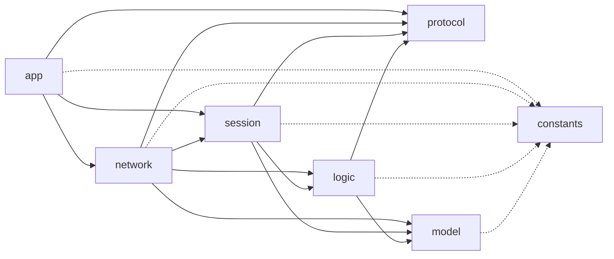
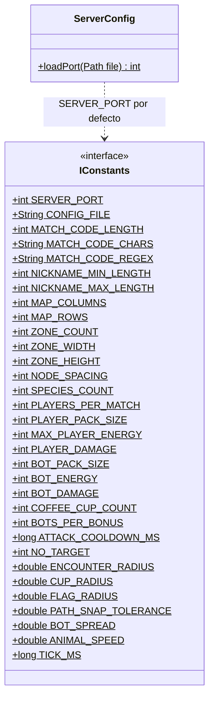
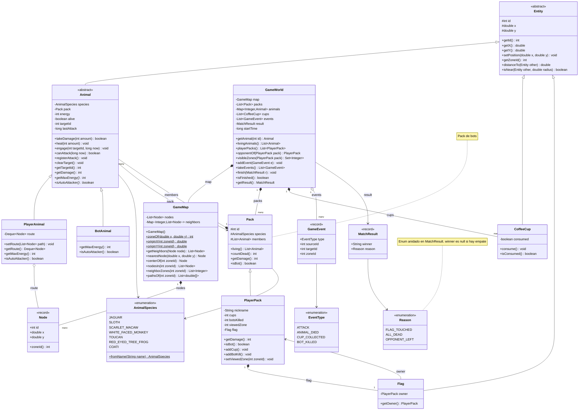
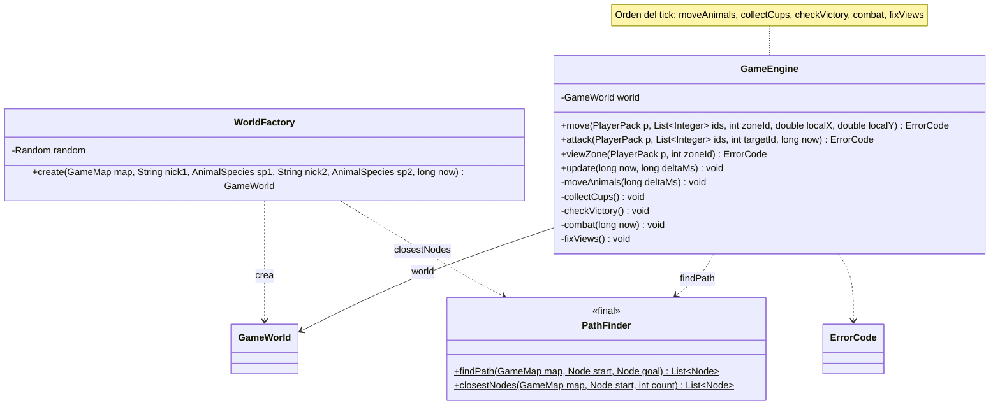
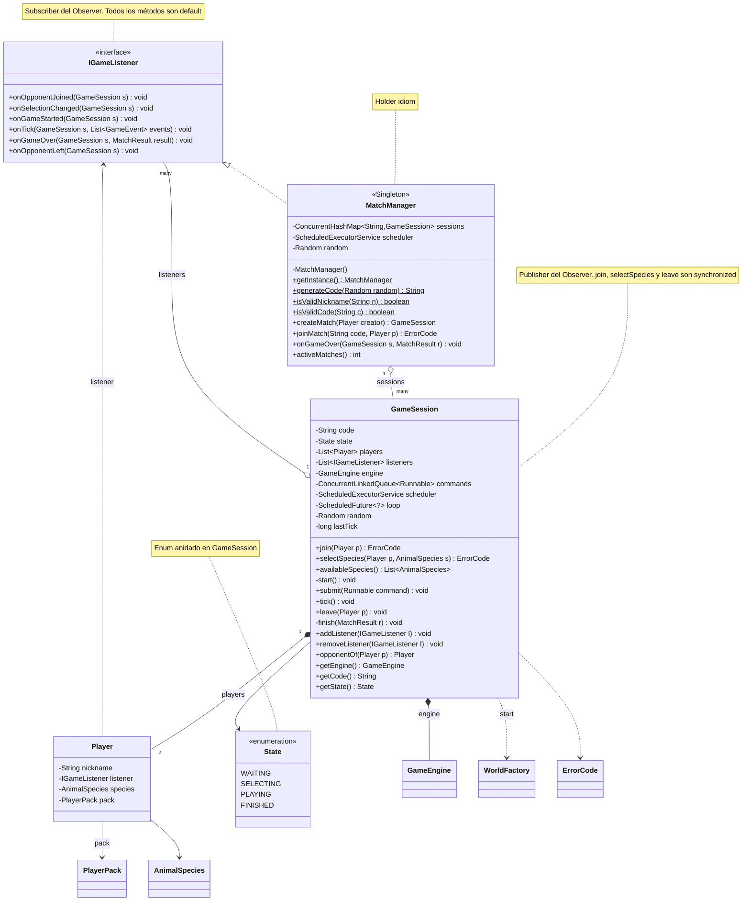
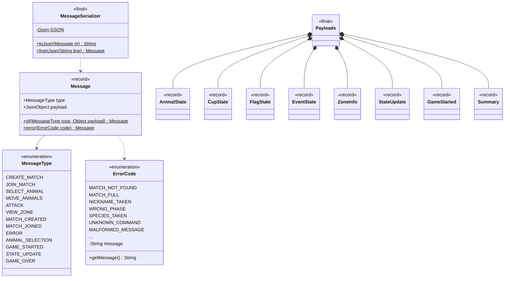
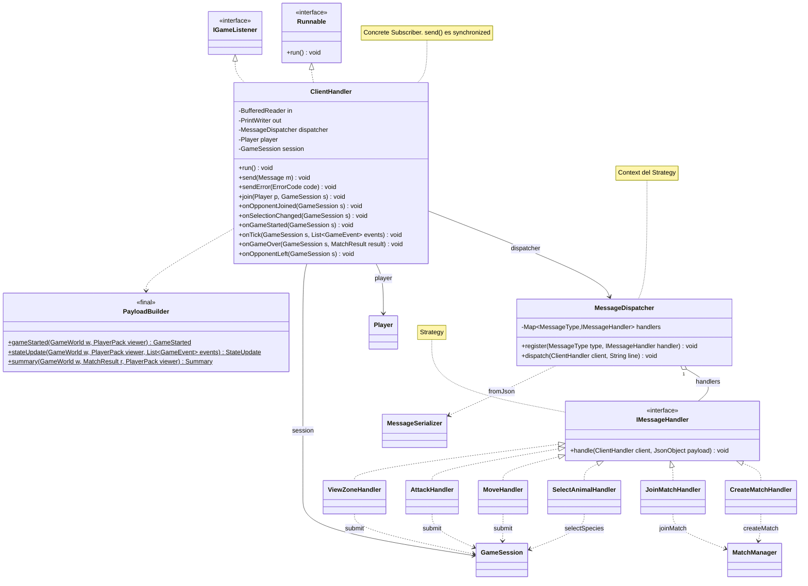
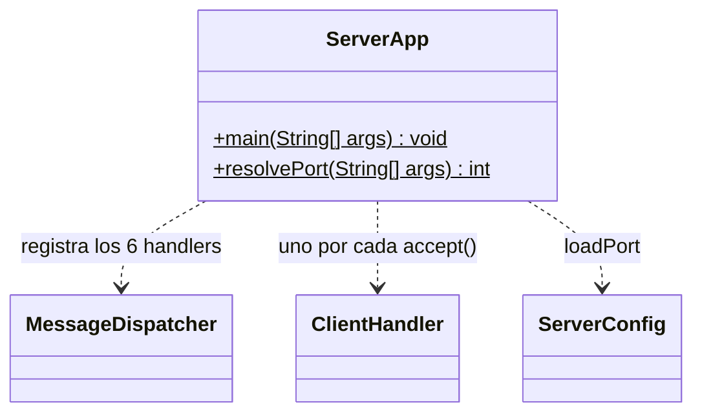

# Specs

### Vista general de paquetes



## Package: constants

**Clase principal testeable:** ServerConfig



```java
public interface IConstants

+int SERVER_PORT = 5050
+String CONFIG_FILE = "config.properties"
+int MATCH_CODE_LENGTH = 4
+String MATCH_CODE_CHARS = "ABCDEFGHIJKLMNOPQRSTUVWXYZ0123456789"
+String MATCH_CODE_REGEX = "[A-Za-z0-9]{4}"
+int NICKNAME_MIN_LENGTH = 3
+int NICKNAME_MAX_LENGTH = 16
+int MAP_COLUMNS = 4
+int MAP_ROWS = 3
+int ZONE_COUNT = MAP_COLUMNS * MAP_ROWS
+int ZONE_WIDTH = 800
+int ZONE_HEIGHT = 600
+int NODE_SPACING = 50 // la mitad de cada zona debe ser múltiplo de NODE_SPACING
+int SPECIES_COUNT = 7
+int PLAYERS_PER_MATCH = 2
+int PLAYER_PACK_SIZE = 10
+int MAX_PLAYER_ENERGY = 20
+int PLAYER_DAMAGE = 2
+int BOT_PACK_SIZE = 4
+int BOT_ENERGY = 10
+int BOT_DAMAGE = 1
+int COFFEE_CUP_COUNT = 10
+int BOTS_PER_BONUS = 2
+long ATTACK_COOLDOWN_MS = 1000
+int NO_TARGET = -1
+double ENCOUNTER_RADIUS = 40
+double CUP_RADIUS = 20
+double FLAG_RADIUS = 25
+double PATH_SNAP_TOLERANCE = 25 // qué tan lejos de un nodo puede caer un clic
+double BOT_SPREAD = 10 // separación visual de los bots alrededor de su nodo
+double ANIMAL_SPEED = 80 // unidades por segundo
+long TICK_MS = 100
```

```java
class ServerConfig
+static int loadPort(Path file) // lee server.port; si el archivo no existe o el valor no es válido, devuelve SERVER_PORT
```

## Package: model

**Clase principal testeable:** Animal (y GameMap)



```java
enum AnimalSpecies
JAGUAR, SLOTH, SCARLET_MACAW, WHITE_FACED_MONKEY, TOUCAN, RED_EYED_TREE_FROG, COATI
+static AnimalSpecies fromName(String name) // texto del JSON → especie
```

```java
enum EventType
ATTACK, ANIMAL_DIED, CUP_COLLECTED, BOT_KILLED
```

```java
record GameEvent(EventType type, int sourceId, int targetId, int zoneId)
```

```java
record MatchResult(String winner, Reason reason)
enum Reason { FLAG_TOUCHED, ALL_DEAD, OPPONENT_LEFT } // enum anidado; winner es null si hay empate
```

```java
record Node(int id, double x, double y) // punto del camino
+int zoneId() // GameMap.zoneOf(x, y)
```

```java
class GameMap
Se construye en el constructor: recorre los caminos horizontales y verticales y crea un nodo cada NODE_SPACING (las intersecciones se reutilizan).
-List<Node> nodes
-Map<Integer, List<Node>> neighbors // id del nodo → nodos vecinos
+GameMap() // genera la cuadrícula de caminos
+static int zoneOf(double x, double y) // fila * MAP_COLUMNS + columna
+static double originX(int zoneId), + static double originY(int zoneId) // esquina superior izquierda de la zona
+List<Node> getNeighbors(Node node)
+Node nearestNode(double x, double y) // nodo más cercano a un punto global
+Node centerOf(int zoneId)
+List<Node> nodesIn(int zoneId)
+List<Integer> neighborZones(int zoneId) // arriba, abajo, izquierda, derecha
+List<double[]> pathsOf(int zoneId) // segmentos de la zona en coordenadas locales {x1, y1, x2, y2}, para el cliente
```

```java
abstract class Entity
#int id · # double x · # double y // coordenadas globales
+int getId(), + double getX(), + double getY(), + void setPosition(double x, double y)
+int getZoneId() // GameMap.zoneOf(x, y)
+double distanceTo(Entity other)
+boolean isNear(Entity other, double radius) // misma zona y distancia ≤ radio
```

```java
abstract class Animal extends Entity
-AnimalSpecies species · - Pack pack · - int energy · - boolean alive
-int targetId // objetivo actual o NO_TARGET
-long lastAttack // para el cooldown
+boolean takeDamage(int amount) // resta energía (nunca baja de 0); devuelve true si murió con ese golpe
+void heal(int amount) // suma energía hasta getMaxEnergy(); no revive muertos
+void engage(int targetId, long now) // fija el objetivo; el primer golpe será 1 s después
+boolean canAttack(long now) // now - lastAttack >= ATTACK_COOLDOWN_MS
+void registerAttack() // lastAttack += ATTACK_COOLDOWN_MS
+void clearTarget(), + int getTargetId()
+int getDamage() // pack.getDamage()
+abstract int getMaxEnergy() // polimorfismo
+abstract boolean isAutoAttacker() // polimorfismo: el bot ataca solo, el jugador no
```

```java
class PlayerAnimal extends Animal
-Deque<Node> route // nodos que le faltan por recorrer
+void setRoute(List<Node> path) // también cancela el ataque
+Deque<Node> getRoute()
+int getMaxEnergy() → MAX_PLAYER_ENERGY · + boolean isAutoAttacker() → false
```

```java
class BotAnimal extends Animal
+int getMaxEnergy() → BOT_ENERGY · + boolean isAutoAttacker() → true
```

```java
class CoffeeCup extends Entity
-boolean consumed · + void consume() · + boolean isConsumed()
```

```java
class Flag extends Entity
-PlayerPack owner · + PlayerPack getOwner()
```

```java
class Pack  (pack de bots)
#int id · # AnimalSpecies species · # List<Animal> members
+List<Animal> living() · + int countDead()
+int getDamage() → BOT_DAMAGE // polimorfismo
+boolean isBot() → true
```

```java
class PlayerPack extends Pack
-String nickname · - int cups · - int botsKilled · - int viewedZone · - Flag flag
+int getDamage() → PLAYER_DAMAGE + cups (sobrescribe)
+boolean isBot() → false
+void addCup()
+void addBotKill() // si botsKilled % BOTS_PER_BONUS == 0, heal(1) a todos los vivos
getters y setViewedZone(int zoneId)
```

```java
class GameWorld
-GameMap map · - List<Pack> packs · - Map<Integer, Animal> animals · - List<CoffeeCup> cups
-List<GameEvent> events · - MatchResult result · - long startTime
+Animal getAnimal(int id)
+List<Animal> livingAnimals()
+List<PlayerPack> playerPacks()
+PlayerPack opponentOf(PlayerPack pack)
+Set<Integer> visibleZones(PlayerPack pack) // zonas con animales vivos del jugador
+void addEvent(GameEvent e) · + List<GameEvent> takeEvents() // devuelve y limpia
+void finish(MatchResult r) · + boolean isFinished() · + MatchResult getResult()
```

## Package: logic

> Todas las reglas del juego. Solo las ejecuta el hilo del tick de cada partida.

**Clase principal testeable:** GameEngine



```java
final class PathFinder  (utilidades static)
+static List<Node> findPath(GameMap map, Node start, Node goal) // BFS con un mapa de "padres"; lista vacía si no hay ruta
+static List<Node> closestNodes(GameMap map, Node start, int count) // BFS limitado; sirve para colocar a los 10 animales del jugador
```

```java
class WorldFactory
-Random random // se inyecta (semilla fija en las pruebas)
+GameWorld create(GameMap map, String nick1, AnimalSpecies sp1, String nick2, AnimalSpecies sp2, long now)
  1. Baraja las 12 zonas y toma 7 distintas.
  2. Jugadores: bandera en el centro de su zona y 10 animales en closestNodes(...).
  3. Bots: 4 animales en el centro de su zona, separados BOT_SPREAD.
  4. Tazas: 10 nodos al azar que no estén en zonas de jugadores ni repetidos.
```

```java
class GameEngine
-GameWorld world
+ErrorCode move(PlayerPack p, List<Integer> ids, int zoneId, double localX, double localY) // zona visible + clic cerca de un nodo; con BFS le arma la ruta a cada animal vivo y propio. Devuelve null si todo salió bien
+ErrorCode attack(PlayerPack p, List<Integer> ids, int targetId, long now) // el objetivo existe, está vivo y no es propio; engage solo a los animales que ya están en rango
+ErrorCode viewZone(PlayerPack p, int zoneId) // solo si es una zona visible
+void update(long now, long deltaMs) // un tick, en este orden:
-void moveAnimals(long deltaMs) // velocidad constante usando deltaMs
-void collectCups() // taza tocada → addCup() + evento
-void checkVictory() // bandera tocada o jugador sin animales → world.finish(...)
-void combat(long now) // 1) los bots eligen al animal más cercano; 2) se sueltan objetivos muertos o lejanos; 3) se suman los golpes de quienes cumplen el cooldown; 4) se aplica todo junto (ANIMAL_DIED, BOT_KILLED → addBotKill())
-void fixViews() // corrige viewedZone si esa zona ya no es visible
```

## Package: session

**Clase principal testeable:** GameSession

> Todos los métodos son default (vacíos), así cada suscriptor sobrescribe solo los que le interesan.



```java
interface IGameListener  (Subscriber del Observer)
+default void onOpponentJoined(GameSession s)
+default void onSelectionChanged(GameSession s)
+default void onGameStarted(GameSession s)
+default void onTick(GameSession s, List<GameEvent> events)
+default void onGameOver(GameSession s, MatchResult result)
+default void onOpponentLeft(GameSession s)
```

```java
class Player
-String nickname · - IGameListener listener · - AnimalSpecies species · - PlayerPack pack
getters y setters
```

```java
class GameSession  (Publisher del Observer)
-String code · - State state // enum State { WAITING, SELECTING, PLAYING, FINISHED } anidado
-List<Player> players · - List<IGameListener> listeners
-GameEngine engine · - ConcurrentLinkedQueue<Runnable> commands
-ScheduledExecutorService scheduler · - ScheduledFuture<?> loop · - Random random · - long lastTick
+synchronized ErrorCode join(Player p) // MATCH_FULL, NICKNAME_TAKEN; con 2 jugadores → onOpponentJoined + onSelectionChanged
+synchronized ErrorCode selectSpecies(Player p, AnimalSpecies s) // WRONG_PHASE, SPECIES_TAKEN; cuando eligen los dos → start()
+List<AnimalSpecies> availableSpecies()
-void start() // WorldFactory + onGameStarted + programa tick() cada TICK_MS
+void submit(Runnable command) // los handlers encolan; se ejecuta en el siguiente tick
+void tick() // ejecuta los comandos encolados, engine.update(...), onTick(...), y termina si hay ganador. Atrapa RuntimeException para que el scheduler no se detenga
+synchronized void leave(Player p) // en juego: encola la victoria del rival; antes: cancela y avisa onOpponentLeft
-void finish(MatchResult r) // cancela el loop + onGameOver
+void addListener(IGameListener l) · + void removeListener(IGameListener l)
+Player opponentOf(Player p) · + GameEngine getEngine() · + String getCode() · + State getState()
```

```java
class MatchManager implements IGameListener  (Singleton, *holder idiom*)
-static class Holder // guarda INSTANCE; la JVM lo crea una sola vez y de forma segura entre hilos, sin locks (Week #10, sección 1.5)
-ConcurrentHashMap<String, GameSession> sessions
-ScheduledExecutorService scheduler // compartido por todas las partidas
-Random random
-MatchManager() // constructor privado
+static MatchManager getInstance()
+static String generateCode(Random random) // 4 caracteres de MATCH_CODE_CHARS
+static boolean isValidNickname(String n) · + static boolean isValidCode(String c)
+GameSession createMatch(Player creator) // repite generateCode hasta que putIfAbsent lo acepte (operación atómica, no hay códigos repetidos)
+ErrorCode joinMatch(String code, Player p) // MATCH_NOT_FOUND o el error de join
+void onGameOver(GameSession s, MatchResult r) // elimina la partida del mapa
+int activeMatches()
```

## Package: protocol

> Contrato JSON con el cliente. No depende de ningún otro paquete del servidor.

**Clase principal testeable:** MessageSerializer



```java
enum MessageType
CREATE_MATCH, JOIN_MATCH, SELECT_ANIMAL, MOVE_ANIMALS, ATTACK, VIEW_ZONE // cliente → servidor
MATCH_CREATED, MATCH_JOINED, ERROR, ANIMAL_SELECTION, GAME_STARTED, STATE_UPDATE, GAME_OVER // servidor → cliente
```

```java
enum ErrorCode
Los códigos de la tabla de arriba
-String message // texto en español · + String getMessage()
```

```java
record Message(MessageType type, JsonObject payload)
+static Message of(MessageType type, Object payload) // convierte cualquier objeto a JsonObject con Gson
+static Message error(ErrorCode code)
```

```java
final class MessageSerializer
-static final Gson GSON
+static String toJson(Message m) // una sola línea
+static Message fromJson(String line) // lanza JsonParseException si el JSON es inválido
```

```java
final class Payloads
// Un solo archivo con los record de respuesta (cada uno ocupa una línea):
// AnimalState, CupState, FlagState, EventState, ZoneInfo, StateUpdate, GameStarted, Summary
```

## Package: network

**Clase principal testeable:** MessageDispatcher



```java
class ClientHandler implements Runnable, IGameListener  (Concrete Subscriber)
-BufferedReader in · - PrintWriter out // UTF-8; se reciben en el constructor (en las pruebas se usan StringReader y StringWriter)
-MessageDispatcher dispatcher
-Player player · - GameSession session // null mientras está en el lobby
+void run() // lee línea por línea → dispatcher.dispatch(this, ...); en finally: session.leave(player) y cierra todo
+synchronized void send(Message m) // sincronizado: escriben este hilo y el hilo del tick
+void sendError(ErrorCode code)
+void join(Player p, GameSession s) // guarda la partida actual
Sobrescribe los 6 métodos de IGameListener: arma el mensaje con PayloadBuilder y lo envía
```

```java
final class PayloadBuilder  (utilidades static)
+static Payloads.GameStarted gameStarted(GameWorld w, PlayerPack viewer) // mapa + estado inicial
+static Payloads.StateUpdate stateUpdate(GameWorld w, PlayerPack viewer, List<GameEvent> events) // solo la zona que mira, en coordenadas locales y con packType relativo
+static Payloads.Summary summary(GameWorld w, MatchResult r, PlayerPack viewer)
```

```java
interface IMessageHandler  (Strategy)
+void handle(ClientHandler client, JsonObject payload)
```

```java
class MessageDispatcher  (Context del Strategy)
-Map<MessageType, IMessageHandler> handlers
+void register(MessageType type, IMessageHandler handler)
+void dispatch(ClientHandler client, String line) // fromJson → busca el handler. Si no hay → UNKNOWN_COMMAND. Si hay error de JSON o falta un campo → MALFORMED_MESSAGE
```

```java
Handlers (todos implements IMessageHandler, ~10 líneas cada uno)
CreateMatchHandler // valida el apodo → MatchManager.createMatch → MATCH_CREATED
JoinMatchHandler // valida el apodo y el código → MatchManager.joinMatch
SelectAnimalHandler // session.selectSpecies(...)
MoveHandler // session.submit(() -> engine.move(...)); si devuelve error → sendError
AttackHandler // session.submit(() -> engine.attack(...))
ViewZoneHandler // session.submit(() -> engine.viewZone(...))
```

## Package: app

**Clase principal testeable:** ServerApp (método resolvePort)



```java
class ServerApp
+static void main(String[] args) // registra los 6 handlers, abre el ServerSocket (try-with-resources) y por cada accept() envía un ClientHandler al pool de hilos
+static int resolvePort(String[] args) // argumento → config.properties → SERVER_PORT
```
